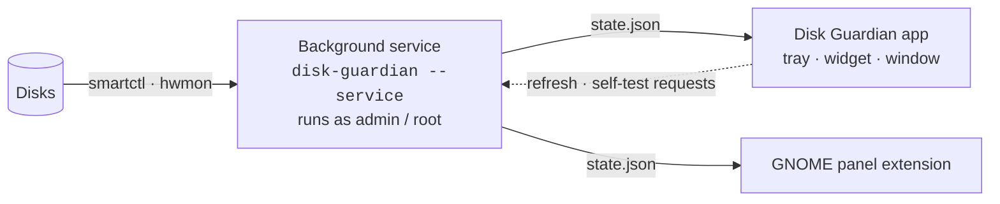

<div align="center">


# Disk Guardian

**Know your disks before they fail.**<br>
SMART health, live temperature and early warnings for every drive, on Windows, macOS and Linux.

[](https://github.com/astatinestudio/disk-guardian/releases/latest)
[](https://github.com/astatinestudio/disk-guardian/releases)
[](https://github.com/astatinestudio/disk-guardian/actions/workflows/desktop.yml)
[](LICENSE)
[](#download)

[Download](#download) · [Features](#features) · [How it works](#how-it-works) · [FAQ](#faq) · [Development](docs/DEVELOPMENT.md)

<sub>English · [简体中文](docs/readme/README_zh.md) · [Русский](docs/readme/README_ru.md) · [فارسی](docs/readme/README_fa.md)</sub>

</div>

---

## Overview

Disks rarely fail without a hint. Reallocated sectors, rising error counters, worn-out flash or a drive that
keeps running hot usually show up in the drive's own SMART data weeks before something breaks.
**Disk Guardian** reads that data for every disk in your computer and turns it into a single health score
with a plain-language explanation. It watches the temperature live and tells you when something changes.

It is free and open source (MIT), and runs on Windows 10/11 (x64, ARM64, x86), macOS 10.15+ and practically every Linux distribution.

## Highlights

<table>
<tr>
<td width="33%" valign="top">

**Health at a glance**<br>
A 0–100 score and a good / warning / critical status for each disk, with every issue explained in plain words.

</td>
<td width="33%" valign="top">

**Live temperature**<br>
Updated every few seconds, with a 24-hour chart. Sleeping hard disks are never woken up just to be measured.

</td>
<td width="33%" valign="top">

**Early warnings**<br>
Notifications when a disk runs too hot (thresholds per drive type) or when its health gets worse.

</td>
</tr>
<tr>
<td valign="top">

**The full picture**<br>
Complete SMART attribute table, NVMe health log, SAS counters, power-on hours and data written.

</td>
<td valign="top">

**Where you already look**<br>
Temperature in the tray or menu bar, a floating widget, the Windows taskbar and a GNOME panel extension.

</td>
<td valign="top">

**Private and lightweight**<br>
Read-only access to your disks, no accounts, no ads and no telemetry. The app itself needs no admin rights.

</td>
</tr>
</table>

## Features

| Area | What you get |
|---|---|
| **Monitoring** | Health score · SMART attributes · NVMe health log · SAS counters · bad and pending sectors · CRC errors · SSD wear · data written / read |
| **Temperature** | Live readings · 24-hour chart with min / max · per-type warning and critical thresholds · °C or °F |
| **Usage** | Total power-on time · today's usage · 14-day daily history |
| **Self-tests** | Short and extended SMART tests with progress and result history |
| **Desktop** | Tray / menu-bar temperature · always-on-top floating widget · start at login · custom disk names |
| **Windows** | Temperatures inside the taskbar · health badges on drives in File Explorer |
| **Linux** | GNOME Shell panel extension · partition map (filesystem, LUKS, mount point, usage) · btrfs device errors and scrub status · `dg-top` live I/O per process |
| **Everywhere** | 19 languages with right-to-left support · light and dark themes · signed automatic updates |

### Supported drives

| Drive | Health | Temperature |
|---|:---:|:---:|
| SATA hard disk (HDD) | ✓ | ✓ |
| SATA SSD | ✓ | ✓ |
| NVMe SSD | ✓ | ✓ |
| SAS / SCSI | ✓ | ✓ |
| USB disk (via USB–SATA / NVMe bridge) | ✓¹ | ✓¹ |
| USB flash drive | basic² | — |

<sub>¹ When the USB adapter passes SMART data through; most do. ² USB sticks have no SMART data. Disk Guardian reports what the system knows about them.</sub>

## Download

| System | Package | x64 | ARM64 | x86 (32-bit) |
|---|---|:---:|:---:|:---:|
| **Windows** 10 / 11 | Installer | [Download](https://github.com/astatinestudio/disk-guardian/releases/latest/download/Disk-Guardian-Windows-Setup-x64.exe) | [Download](https://github.com/astatinestudio/disk-guardian/releases/latest/download/Disk-Guardian-Windows-Setup-arm64.exe) | [Download](https://github.com/astatinestudio/disk-guardian/releases/latest/download/Disk-Guardian-Windows-Setup-x86.exe) |
| | Portable (zip) | [Download](https://github.com/astatinestudio/disk-guardian/releases/latest/download/Disk-Guardian-Windows-Portable-x64.zip) | [Download](https://github.com/astatinestudio/disk-guardian/releases/latest/download/Disk-Guardian-Windows-Portable-arm64.zip) | [Download](https://github.com/astatinestudio/disk-guardian/releases/latest/download/Disk-Guardian-Windows-Portable-x86.zip) |
| **macOS** 10.15+ | Disk image (.dmg) | [Intel](https://github.com/astatinestudio/disk-guardian/releases/latest/download/Disk-Guardian-macOS-x64.dmg) | [Apple silicon](https://github.com/astatinestudio/disk-guardian/releases/latest/download/Disk-Guardian-macOS-aarch64.dmg) | — |
| **Debian · Ubuntu · Mint** | .deb | [Download](https://github.com/astatinestudio/disk-guardian/releases/latest/download/Disk-Guardian-Linux-amd64.deb) | [Download](https://github.com/astatinestudio/disk-guardian/releases/latest/download/Disk-Guardian-Linux-arm64.deb) | — |
| **Fedora · openSUSE** | .rpm | [Download](https://github.com/astatinestudio/disk-guardian/releases/latest/download/Disk-Guardian-Linux-x86_64.rpm) | [Download](https://github.com/astatinestudio/disk-guardian/releases/latest/download/Disk-Guardian-Linux-aarch64.rpm) | — |
| **Any Linux (Arch, Manjaro, …)** | AppImage (portable) | [Download](https://github.com/astatinestudio/disk-guardian/releases/latest/download/Disk-Guardian-Linux-x86_64.AppImage) | [Download](https://github.com/astatinestudio/disk-guardian/releases/latest/download/Disk-Guardian-Linux-aarch64.AppImage) | — |

**Which one should I pick?**

- **Installer** for everyday use: it sets up the background service and keeps itself up to date.
- **Portable** runs from any folder or USB stick without installing. It does not update itself.
- **ARM64** is for Windows on ARM (Snapdragon laptops, Surface Pro X) and ARM Linux; **x86** only for old 32-bit Windows.
- The **.deb** and **.rpm** packages include the background service and the GNOME panel extension. The **AppImage** runs on any distribution; install `smartmontools` with your package manager first.

All files, checksums and release notes are on the [releases page](https://github.com/astatinestudio/disk-guardian/releases).

**Linux and macOS: install or update with one command**

```bash
curl -fsSL https://raw.githubusercontent.com/astatinestudio/disk-guardian/main/install.sh | bash
```

The script downloads the latest release for your system, verifies it against the release's `SHA256SUMS.txt`
and installs it. Run it again any time to update.

> [!NOTE]
> The builds are not code-signed yet, so Windows SmartScreen or macOS Gatekeeper may ask for confirmation
> on first start. On macOS, right-click the app and choose **Open**.

> [!TIP]
> On GNOME, log out and back in once after installing to see disk temperatures in the top panel.

## How it works



Reading SMART data requires administrator rights, but a desktop app shouldn't run with them. So the work is split:

- **A small background service** (Windows service, launchd daemon or systemd unit) reads the disks on a
  schedule and writes the raw data to a local file. It never wakes a sleeping hard disk.
- **The app** runs as your normal user, analyses that data and shows it. The same analysis code is shared
  with the GNOME extension, so both always agree.
- **Requests** such as "refresh now" or "start a self-test" go back to the service through a small queue
  that only local users can write to (on Linux, only members of the `sudo` group).

## Privacy and safety

- **Read-only.** Disk Guardian only reads information from your disks. The only thing it ever asks a drive to do
  is run a SMART self-test, and only when you start one. The test runs inside the drive.
- **No telemetry.** There are no accounts, analytics or ads. The only network request is the update check,
  which downloads [`updates.json`](updates.json) from this repository. You can turn it off in **Settings → Updates**.
- **Verified updates.** Every release ships a `SHA256SUMS.txt` signed with the project's Ed25519 key. The app
  installs an update only if the signature and the file's hash both match.

## Command line (Linux)

```bash
sudo dg-top                           # live I/O per disk and per process, htop-style
journalctl -u disk-guardian -f        # follow the service log
sudo disk-guardian --once             # read every disk once and print the raw JSON
sudo systemctl restart disk-guardian  # apply changes to /etc/diskguardian/collector.conf
```

All service settings are described in [Development → Collector settings](docs/DEVELOPMENT.md#collector-settings-linux).

## FAQ

<details>
<summary><b>How reliable is the health score?</b></summary>

It reflects what the drive reports about itself: reallocated and pending sectors, media and CRC errors,
failed self-tests and, for SSDs, remaining life. That catches most slow failures early. Sudden failures,
such as a dead controller, can still happen without warning, so keep backups of important data.
</details>

<details>
<summary><b>Will it keep my hard disks from sleeping?</b></summary>

No. Sleeping hard disks are skipped and read again once they wake up on their own. The one exception is a disk
that has never been read at all: it is woken once so it doesn't stay empty (`wake_for_first_scan`, can be turned off).
SSD and NVMe temperatures come from cheap kernel sensors and cause no disk activity.
</details>

<details>
<summary><b>Why does a disk show "unknown"?</b></summary>

The drive doesn't provide SMART data. This is typical for virtual machine disks, disks behind a hardware
RAID controller and some USB adapters.
</details>

<details>
<summary><b>How do updates work?</b></summary>

The app checks for a new version at start and every few hours. When one is available, it shows a banner, and
**Download and install** updates it in place after a single administrator prompt. You can turn automatic checks off in
**Settings → Updates**. On Linux and macOS you can also run the install command above again.
</details>

<details>
<summary><b>How do I uninstall it?</b></summary>

- **Windows:** Settings → Apps → Disk Guardian → Uninstall.
- **macOS:** `sudo "/Applications/Disk Guardian.app/Contents/MacOS/disk-guardian" --uninstall-service`, then move the app to the Trash.
- **Linux:** `sudo apt remove disk-guardian`, or `sudo apt purge disk-guardian` to also remove history and settings.
</details>

<details>
<summary><b>What isn't supported yet?</b></summary>

Individual disks behind hardware RAID controllers (megaraid and similar), and 32-bit ARM Linux.
The GNOME panel extension needs GNOME 45 or newer; other desktops use the tray icon and the floating widget.
</details>

## Contributing

Bug reports and ideas are welcome in [Issues](https://github.com/astatinestudio/disk-guardian/issues).
Pull requests too: see [Development](docs/DEVELOPMENT.md) for building, testing and the project layout.

**Translations** live in [`extension/lib/locales/`](extension/lib/locales), one file per language. Improvements
from native speakers are especially welcome. `node desktop/scripts/check-locales.mjs` confirms that nothing is missing.

## Credits

- [smartmontools](https://github.com/smartmontools/smartmontools) (GPL-2.0): `smartctl` is shipped unchanged as a separate program.
- [Tauri](https://tauri.app) (MIT / Apache-2.0): the cross-platform app framework.
- [Material Symbols](https://fonts.google.com/icons) (Apache-2.0): icons.
- [Vazirmatn](https://github.com/rastikerdar/vazirmatn) (SIL Open Font License 1.1): the Persian / Arabic font.

> [!IMPORTANT]
> Disk Guardian is provided as is, without warranty of any kind. A health score is an estimate, not a guarantee:
> always keep backups of data you care about.

---

<div align="center">
<sub>Created by <b>Reza Ardi</b> · created November 15, 2026 · last updated November 27, 2026<br>Released under the <a href="LICENSE">MIT License</a></sub>
</div>
