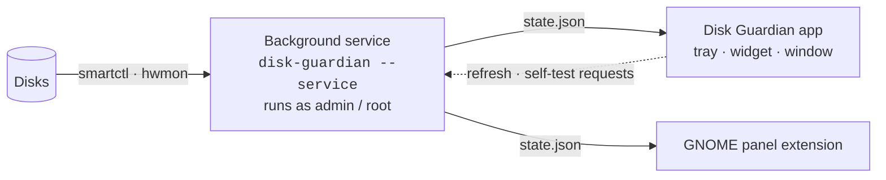

<div align="center">


# Disk Guardian

<div dir="rtl">

**دیسک‌هایتان را پیش از خراب شدن بشناسید.**<br>
سلامت SMART، دمای زنده و هشدار زودهنگام برای همه‌ی دیسک‌ها، روی ویندوز، مک و لینوکس.

</div>

[](https://github.com/astatinestudio/disk-guardian/releases/latest)
[](https://github.com/astatinestudio/disk-guardian/releases)
[](https://github.com/astatinestudio/disk-guardian/actions/workflows/desktop.yml)
[](../../LICENSE)
[](#download)

<div dir="rtl">

[دانلود](#download) · [امکانات](#features) · [نحوه‌ی کار](#how-it-works) · [پرسش‌های رایج](#faq) · [توسعه](../DEVELOPMENT.md)

</div>

<sub>[English](../../README.md) · [简体中文](README_zh.md) · [Русский](README_ru.md) · فارسی</sub>

</div>

---

<div dir="rtl">

## معرفی

دیسک‌ها به‌ندرت بی‌خبر خراب می‌شوند. سکتورهای جایگزین‌شده، بالا رفتن شمارنده‌ی خطاها، فرسوده شدن حافظه‌ی فلش یا
دیسکی که مدام داغ کار می‌کند، معمولاً هفته‌ها پیش از خرابی در اطلاعات SMART خود دیسک دیده می‌شوند.
**Disk Guardian** این اطلاعات را برای همه‌ی دیسک‌های کامپیوتر شما می‌خواند و آن را به یک امتیاز سلامت با توضیحی ساده
تبدیل می‌کند. دما را لحظه‌به‌لحظه زیر نظر دارد و هر تغییری را به شما خبر می‌دهد.

رایگان و متن‌باز (مجوز GPL-3.0) است و روی ویندوز ۱۰ و ۱۱ (x64، ARM64، x86)، مک ۱۰.۱۵ به بالا و تقریباً همه‌ی توزیع‌های لینوکس اجرا می‌شود.

## ویژگی‌های برجسته

</div>

<table dir="rtl">
<tr>
<td width="33%" valign="top">

**سلامت در یک نگاه**<br>
امتیاز ۰ تا ۱۰۰ و وضعیت سالم / هشدار / بحرانی برای هر دیسک، با توضیح ساده‌ی هر مشکل.

</td>
<td width="33%" valign="top">

**دمای زنده**<br>
هر چند ثانیه به‌روز می‌شود، با نمودار ۲۴ ساعت. هاردهای در حال خواب فقط برای اندازه‌گیری بیدار نمی‌شوند.

</td>
<td width="33%" valign="top">

**هشدار زودهنگام**<br>
اعلان وقتی دیسک بیش از حد داغ می‌شود (با آستانه‌ی جدا برای هر نوع دیسک) یا وضعیت سلامتش بدتر می‌شود.

</td>
</tr>
<tr>
<td valign="top">

**تصویر کامل**<br>
جدول کامل ویژگی‌های SMART، گزارش سلامت NVMe، شمارنده‌های SAS، ساعت کارکرد و حجم داده‌ی نوشته‌شده.

</td>
<td valign="top">

**همان جایی که نگاه می‌کنید**<br>
دما کنار ساعت یا در نوار منو، ویجت شناور، تسک‌بار ویندوز و افزونه‌ی پنل GNOME.

</td>
<td valign="top">

**خصوصی و سبک**<br>
فقط خواندن اطلاعات دیسک‌ها، بدون حساب کاربری، تبلیغات و ارسال اطلاعات. خود برنامه دسترسی مدیر نمی‌خواهد.

</td>
</tr>
</table>

<div dir="rtl">

<a id="features"></a>
## امکانات

| بخش | امکانات |
|---|---|
| **پایش** | امتیاز سلامت · ویژگی‌های SMART · گزارش سلامت NVMe · شمارنده‌های SAS · سکتورهای خراب و در انتظار · خطاهای CRC · فرسودگی SSD · حجم داده‌ی نوشته / خوانده‌شده |
| **دما** | دمای زنده · نمودار ۲۴ ساعت با کمینه / بیشینه · آستانه‌ی هشدار و بحرانی برای هر نوع دیسک · سلسیوس یا فارنهایت |
| **کارکرد** | کل زمان روشن بودن · کارکرد امروز · تاریخچه‌ی روزانه‌ی ۱۴ روز |
| **خودآزمایی** | تست کوتاه و کامل SMART با نمایش پیشرفت و تاریخچه‌ی نتایج |
| **دسکتاپ** | دما کنار ساعت / در نوار منو · ویجت شناور همیشه‌رو · اجرا هنگام ورود · نام دلخواه برای دیسک‌ها |
| **ویندوز** | دما داخل تسک‌بار · نشان سلامت روی درایوها در File Explorer |
| **لینوکس** | افزونه‌ی پنل GNOME Shell · نقشه‌ی پارتیشن‌ها (فایل‌سیستم، LUKS، محل اتصال، درصد پر بودن) · خطاهای btrfs و وضعیت scrub · `dg-top` برای فعالیت زنده‌ی هر پردازه |
| **همه‌جا** | ۱۹ زبان با پشتیبانی راست‌چین (فارسی با اعداد فارسی و تقویم شمسی) · پوسته‌ی روشن و تیره · به‌روزرسانی خودکار امضاشده |

### دیسک‌های پشتیبانی‌شده

| دیسک | سلامت | دما |
|---|:---:|:---:|
| هارد ساتا (HDD) | ✓ | ✓ |
| SSD ساتا | ✓ | ✓ |
| SSD نوع NVMe | ✓ | ✓ |
| SAS / SCSI | ✓ | ✓ |
| دیسک USB (از طریق مبدل USB به SATA / NVMe) | ✓¹ | ✓¹ |
| فلش USB | پایه² | — |

<sub>¹ به شرطی که مبدل USB اطلاعات SMART را عبور دهد؛ بیشترشان می‌دهند. ² فلش‌ها اطلاعات SMART ندارند؛ Disk Guardian آنچه سیستم درباره‌شان می‌داند را نشان می‌دهد.</sub>

<a id="download"></a>
## دانلود

<table>
<thead>
<tr><th>سیستم‌عامل</th><th>دانلود</th><th></th></tr>
</thead>
<tbody>
<tr><td rowspan="2">ویندوز<br><sub>۱۰ و ۱۱</sub></td><td><a href="https://github.com/astatinestudio/disk-guardian/releases/latest/download/Disk-Guardian-Windows-Setup-x64.exe"></a><br><a href="https://github.com/astatinestudio/disk-guardian/releases/latest/download/Disk-Guardian-Windows-Setup-arm64.exe"></a><br><a href="https://github.com/astatinestudio/disk-guardian/releases/latest/download/Disk-Guardian-Windows-Setup-x86.exe"></a></td><td>نصب‌کننده</td></tr>
<tr><td><a href="https://github.com/astatinestudio/disk-guardian/releases/latest/download/Disk-Guardian-Windows-Portable-x64.zip"></a><br><a href="https://github.com/astatinestudio/disk-guardian/releases/latest/download/Disk-Guardian-Windows-Portable-arm64.zip"></a><br><a href="https://github.com/astatinestudio/disk-guardian/releases/latest/download/Disk-Guardian-Windows-Portable-x86.zip"></a></td><td>بدون نصب، از هر پوشه‌ای اجرا می‌شود</td></tr>
<tr><td>مک<br><sub>۱۰.۱۵ به بالا</sub></td><td><a href="https://github.com/astatinestudio/disk-guardian/releases/latest/download/Disk-Guardian-macOS-aarch64.dmg"></a><br><a href="https://github.com/astatinestudio/disk-guardian/releases/latest/download/Disk-Guardian-macOS-x64.dmg"></a></td><td>Apple silicon (M1 و جدیدتر) یا اینتل</td></tr>
<tr><td rowspan="3">لینوکس</td><td><a href="https://github.com/astatinestudio/disk-guardian/releases/latest/download/Disk-Guardian-Linux-amd64.deb"></a><br><a href="https://github.com/astatinestudio/disk-guardian/releases/latest/download/Disk-Guardian-Linux-arm64.deb"></a></td><td>دبیان · اوبونتو · مینت</td></tr>
<tr><td><a href="https://github.com/astatinestudio/disk-guardian/releases/latest/download/Disk-Guardian-Linux-x86_64.rpm"></a><br><a href="https://github.com/astatinestudio/disk-guardian/releases/latest/download/Disk-Guardian-Linux-aarch64.rpm"></a></td><td>فدورا · اوپن‌سوزه</td></tr>
<tr><td><a href="https://github.com/astatinestudio/disk-guardian/releases/latest/download/Disk-Guardian-Linux-x86_64.AppImage"></a><br><a href="https://github.com/astatinestudio/disk-guardian/releases/latest/download/Disk-Guardian-Linux-aarch64.AppImage"></a></td><td>همه‌ی توزیع‌ها (آرچ، مانجارو و …)، پرتابل</td></tr>
</tbody>
</table>

**کدام را انتخاب کنم؟**

- **نصب‌کننده** برای استفاده‌ی روزمره: سرویس پس‌زمینه را راه می‌اندازد و خودش را به‌روز نگه می‌دارد.
- **پرتابل** بدون نصب از هر پوشه یا فلشی اجرا می‌شود و خودش را به‌روز نمی‌کند.
- **ARM64** برای ویندوز روی ARM (لپ‌تاپ‌های Snapdragon، Surface Pro X) و لینوکس ARM است؛ **x86** فقط برای ویندوزهای قدیمی ۳۲ بیتی.
- بسته‌های **deb** و **rpm** سرویس پس‌زمینه و افزونه‌ی پنل GNOME را دارند. **AppImage** روی هر توزیعی اجرا می‌شود؛ قبلش `smartmontools` را با مدیر بسته‌ی سیستم نصب کنید.

همه‌ی فایل‌ها، هش‌ها و توضیحات هر نسخه در [صفحه‌ی انتشارها](https://github.com/astatinestudio/disk-guardian/releases) است.

**لینوکس و مک: نصب یا به‌روزرسانی با یک دستور**

</div>

```bash
curl -fsSL https://raw.githubusercontent.com/astatinestudio/disk-guardian/main/install.sh | bash
```

<div dir="rtl">

این اسکریپت آخرین نسخه را برای سیستم شما دانلود می‌کند، آن را با `SHA256SUMS.txt` همان نسخه بررسی می‌کند و نصب می‌کند.
برای به‌روزرسانی هر وقت خواستید دوباره اجرایش کنید.

> [!NOTE]
> برنامه هنوز امضای دیجیتال ندارد، پس ممکن است SmartScreen ویندوز یا Gatekeeper مک در اولین اجرا تأیید بخواهند.
> در مک روی برنامه کلیک راست کنید و **Open** را بزنید.

> [!TIP]
> در GNOME بعد از نصب یک بار خارج و دوباره وارد شوید تا دمای دیسک‌ها در پنل بالا دیده شود.

<a id="how-it-works"></a>
## نحوه‌ی کار

</div>



<div dir="rtl">

خواندن اطلاعات SMART دسترسی مدیر می‌خواهد، ولی برنامه‌ی دسکتاپ نباید با این دسترسی اجرا شود. برای همین کار تقسیم شده است:

- **یک سرویس کوچک پس‌زمینه** (سرویس ویندوز، launchd یا systemd) دیسک‌ها را در فاصله‌های منظم می‌خواند و داده‌ی خام را
  در یک فایل محلی می‌نویسد. هارد خواب را بیدار نمی‌کند.
- **برنامه** با کاربر عادی اجرا می‌شود، این داده را تحلیل می‌کند و نمایش می‌دهد. کد تحلیل با افزونه‌ی GNOME مشترک است،
  پس هر دو همیشه یک نتیجه نشان می‌دهند.
- **درخواست‌ها** مثل «به‌روزرسانی فوری» یا «شروع خودآزمایی» از طریق یک صف کوچک به سرویس می‌رسند که فقط کاربران همان
  کامپیوتر می‌توانند در آن بنویسند (در لینوکس فقط اعضای گروه `sudo`).

## حریم خصوصی و امنیت

- **فقط خواندن.** Disk Guardian فقط اطلاعات دیسک‌ها را می‌خواند. تنها کاری که از دیسک می‌خواهد خودآزمایی SMART است، آن هم
  فقط وقتی شما شروعش کنید؛ تست داخل خود دیسک اجرا می‌شود.
- **بدون ارسال اطلاعات.** حساب کاربری، آمارگیری و تبلیغات ندارد. تنها ارتباط اینترنتی، بررسی به‌روزرسانی است که فایل
  [`updates.json`](../../updates.json) را از همین مخزن می‌خواند و در **تنظیمات ← به‌روزرسانی‌ها** خاموش‌شدنی است.
- **به‌روزرسانی تأییدشده.** هر نسخه یک `SHA256SUMS.txt` امضاشده با کلید Ed25519 پروژه دارد و برنامه فقط وقتی به‌روزرسانی را
  نصب می‌کند که هم امضا و هم هش فایل درست باشد.

## خط فرمان (لینوکس)

</div>

```bash
sudo dg-top                           # فعالیت زنده‌ی هر دیسک و هر پردازه، به سبک htop
journalctl -u disk-guardian -f        # دنبال کردن لاگ سرویس
sudo disk-guardian --once             # خواندن یک‌باره‌ی همه‌ی دیسک‌ها و نمایش JSON خام
sudo systemctl restart disk-guardian  # اعمال تغییرات /etc/diskguardian/collector.conf
```

<div dir="rtl">

همه‌ی تنظیمات سرویس در [راهنمای توسعه ← Collector settings](../DEVELOPMENT.md#collector-settings-linux) آمده است.

<a id="faq"></a>
## پرسش‌های رایج

<details>
<summary><b>امتیاز سلامت چقدر قابل اعتماد است؟</b></summary>

بازتاب چیزی است که خود دیسک گزارش می‌دهد: سکتورهای جایگزین‌شده و در انتظار، خطاهای رسانه و CRC، شکست خودآزمایی و برای SSD
عمر باقی‌مانده. این‌ها بیشتر خرابی‌های تدریجی را زود نشان می‌دهند. خرابی ناگهانی (مثلاً از کار افتادن کنترلر) همچنان ممکن است
بدون هشدار رخ دهد، پس از داده‌های مهم نسخه‌ی پشتیبان داشته باشید.
</details>

<details>
<summary><b>جلوی خواب رفتن هارد را می‌گیرد؟</b></summary>

نه. هاردهای در حال خواب نادیده گرفته می‌شوند و وقتی خودشان بیدار شدند دوباره خوانده می‌شوند. تنها استثنا دیسکی است که تا
حالا اصلاً خوانده نشده: یک بار بیدار می‌شود تا خالی نماند (`wake_for_first_scan`، قابل خاموش کردن). دمای SSD و NVMe از
سنسورهای کرنل خوانده می‌شود و هیچ فعالیتی روی دیسک ایجاد نمی‌کند.
</details>

<details>
<summary><b>چرا یک دیسک وضعیت «نامشخص» دارد؟</b></summary>

آن دیسک اطلاعات SMART نمی‌دهد. این برای دیسک‌های ماشین مجازی، دیسک‌های پشت کارت RAID سخت‌افزاری و بعضی مبدل‌های USB معمول است.
</details>

<details>
<summary><b>به‌روزرسانی چطور کار می‌کند؟</b></summary>

برنامه هنگام اجرا و هر چند ساعت یک بار نسخه‌ی جدید را بررسی می‌کند. اگر نسخه‌ی جدید باشد بنری نشان می‌دهد و دکمه‌ی
**دانلود و نصب** با یک بار تأیید مدیر سیستم آن را نصب می‌کند. بررسی خودکار را می‌توانید در **تنظیمات ← به‌روزرسانی‌ها**
خاموش کنید. در لینوکس و مک دستور نصب بالا هم دوباره کار می‌کند.
</details>

<details>
<summary><b>چطور حذفش کنم؟</b></summary>

- **ویندوز:** Settings ← Apps ← Disk Guardian ← Uninstall.
- **مک:** دستور `sudo "/Applications/Disk Guardian.app/Contents/MacOS/disk-guardian" --uninstall-service` و بعد انتقال برنامه به سطل زباله.
- **لینوکس:** `sudo apt remove disk-guardian`، یا `sudo apt purge disk-guardian` برای حذف تاریخچه و تنظیمات.
</details>

<details>
<summary><b>چه چیزهایی هنوز پشتیبانی نمی‌شود؟</b></summary>

دیسک‌های پشت کارت RAID سخت‌افزاری (megaraid و مشابه آن) و لینوکس ARM ۳۲ بیتی. افزونه‌ی پنل به GNOME 45 یا جدیدتر
نیاز دارد؛ در محیط‌های دیگر آیکون کنار ساعت و ویجت شناور در دسترس است.
</details>

## مشارکت

گزارش اشکال و پیشنهادها را در [Issues](https://github.com/astatinestudio/disk-guardian/issues) ثبت کنید. Pull request هم
خوش‌آمد است؛ برای ساخت، آزمون و ساختار پروژه [راهنمای توسعه](../DEVELOPMENT.md) را ببینید.

**ترجمه‌ها** در [`extension/lib/locales/`](../../extension/lib/locales) هستند، برای هر زبان یک فایل. بهبود ترجمه‌ها توسط
اهل زبان به‌خصوص ارزشمند است. دستور `node desktop/scripts/check-locales.mjs` بررسی می‌کند که چیزی جا نیفتاده باشد.

## سپاسگزاری

- [smartmontools](https://github.com/smartmontools/smartmontools) با مجوز GPL-2.0: فایل `smartctl` بدون تغییر و به‌صورت برنامه‌ی جداگانه همراه می‌شود.
- [Tauri](https://tauri.app) با مجوز MIT / Apache-2.0: چارچوب ساخت برنامه برای همه‌ی سیستم‌عامل‌ها.
- [Material Symbols](https://fonts.google.com/icons) با مجوز Apache-2.0: آیکون‌ها.
- [وزیرمتن](https://github.com/rastikerdar/vazirmatn) با مجوز SIL Open Font License 1.1: فونت فارسی و عربی.

> [!IMPORTANT]
> Disk Guardian همان‌طور که هست و بدون هیچ ضمانتی ارائه می‌شود. امتیاز سلامت یک تخمین است، نه تضمین:
> همیشه از داده‌های مهم خود نسخه‌ی پشتیبان داشته باشید.

</div>

---

<div align="center">
<sub>ساخته‌ی <b>Reza Ardi</b> · تاریخ ساخت ۲۴ آبان ۱۴۰۵ · آخرین به‌روزرسانی ۶ آذر ۱۴۰۵<br>منتشرشده با <a href="../../LICENSE">مجوز GNU GPL نسخه‌ی ۳</a></sub>
</div>
