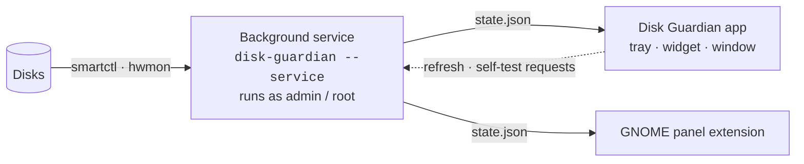

<div align="center">


# Disk Guardian

**Узнайте о проблемах с диском до того, как он откажет.**<br>
Состояние SMART, температура в реальном времени и ранние предупреждения для каждого диска в Windows, macOS и Linux.

[](https://github.com/astatinestudio/disk-guardian/releases/latest)
[](https://github.com/astatinestudio/disk-guardian/releases)
[](https://github.com/astatinestudio/disk-guardian/actions/workflows/desktop.yml)
[](../../LICENSE)
[](#download)

[Скачать](#download) · [Возможности](#features) · [Как это работает](#how-it-works) · [Вопросы и ответы](#faq) · [Разработка](../DEVELOPMENT.md)

<sub>[English](../../README.md) · [简体中文](README_zh.md) · Русский · [فارسی](README_fa.md)</sub>

</div>

---

## Обзор

Диски редко выходят из строя без предупреждения. Переназначенные секторы, растущие счётчики ошибок, изношенная
флеш-память или постоянно перегревающийся диск обычно видны в собственных данных SMART накопителя за недели до поломки.
**Disk Guardian** читает эти данные для каждого диска компьютера и превращает их в единую оценку состояния с понятным
объяснением. Он следит за температурой в реальном времени и сообщает, когда что-то меняется.

Программа бесплатная, с открытым исходным кодом (GPL-3.0), работает в Windows 10/11 (x64, ARM64, x86), macOS 10.15+ и практически любом дистрибутиве Linux.

## Главное

<table>
<tr>
<td width="33%" valign="top">

**Состояние с первого взгляда**<br>
Оценка от 0 до 100 и статус «хорошо / внимание / критично» для каждого диска, каждая проблема объяснена простыми словами.

</td>
<td width="33%" valign="top">

**Температура в реальном времени**<br>
Обновляется каждые несколько секунд, есть график за 24 часа. Спящие жёсткие диски не будятся ради измерения.

</td>
<td width="33%" valign="top">

**Ранние предупреждения**<br>
Уведомления, если диск перегревается (пороги для каждого типа дисков) или его состояние ухудшается.

</td>
</tr>
<tr>
<td valign="top">

**Полная картина**<br>
Полная таблица атрибутов SMART, журнал состояния NVMe, счётчики SAS, время работы и объём записанных данных.

</td>
<td valign="top">

**Там, куда вы и так смотрите**<br>
Температура в трее или строке меню, плавающий виджет, панель задач Windows и расширение панели GNOME.

</td>
<td valign="top">

**Конфиденциально и легко**<br>
Только чтение дисков, без учётных записей, рекламы и телеметрии. Самому приложению права администратора не нужны.

</td>
</tr>
</table>

<a id="features"></a>
## Возможности

| Раздел | Что есть |
|---|---|
| **Мониторинг** | Оценка состояния · атрибуты SMART · журнал состояния NVMe · счётчики SAS · плохие и ожидающие секторы · ошибки CRC · износ SSD · объём записи / чтения |
| **Температура** | Показания в реальном времени · график за 24 часа с мин. / макс. · пороги предупреждения и критического уровня для каждого типа · °C или °F |
| **Использование** | Общее время работы · работа за сегодня · история по дням за 14 дней |
| **Самотестирование** | Короткий и расширенный тесты SMART с ходом выполнения и историей результатов |
| **Рабочий стол** | Температура в трее / строке меню · плавающий виджет поверх окон · запуск при входе · свои названия дисков |
| **Windows** | Температура на панели задач · значки состояния на дисках в Проводнике |
| **Linux** | Расширение панели GNOME Shell · карта разделов (файловая система, LUKS, точка монтирования, заполненность) · ошибки устройств btrfs и состояние scrub · `dg-top` — ввод-вывод по процессам в реальном времени |
| **Везде** | 19 языков, включая письмо справа налево · светлая и тёмная темы · подписанные автоматические обновления |

### Поддерживаемые диски

| Диск | Состояние | Температура |
|---|:---:|:---:|
| Жёсткий диск SATA (HDD) | ✓ | ✓ |
| SSD SATA | ✓ | ✓ |
| SSD NVMe | ✓ | ✓ |
| SAS / SCSI | ✓ | ✓ |
| USB-диск (через мост USB–SATA / NVMe) | ✓¹ | ✓¹ |
| USB-флешка | базово² | — |

<sub>¹ Если USB-переходник передаёт данные SMART; большинство передаёт. ² У флешек нет данных SMART, Disk Guardian показывает то, что о них знает система.</sub>

<a id="download"></a>
## Скачать

<table>
<thead>
<tr><th>Система</th><th>Скачать</th><th></th></tr>
</thead>
<tbody>
<tr><td rowspan="2">Windows<br><sub>10 / 11</sub></td><td><a href="https://github.com/astatinestudio/disk-guardian/releases/latest/download/Disk-Guardian-Windows-Setup-x64.exe"></a><br><a href="https://github.com/astatinestudio/disk-guardian/releases/latest/download/Disk-Guardian-Windows-Setup-arm64.exe"></a><br><a href="https://github.com/astatinestudio/disk-guardian/releases/latest/download/Disk-Guardian-Windows-Setup-x86.exe"></a></td><td>Установщик</td></tr>
<tr><td><a href="https://github.com/astatinestudio/disk-guardian/releases/latest/download/Disk-Guardian-Windows-Portable-x64.zip"></a><br><a href="https://github.com/astatinestudio/disk-guardian/releases/latest/download/Disk-Guardian-Windows-Portable-arm64.zip"></a><br><a href="https://github.com/astatinestudio/disk-guardian/releases/latest/download/Disk-Guardian-Windows-Portable-x86.zip"></a></td><td>Без установки, из любой папки</td></tr>
<tr><td>macOS<br><sub>10.15+</sub></td><td><a href="https://github.com/astatinestudio/disk-guardian/releases/latest/download/Disk-Guardian-macOS-aarch64.dmg"></a><br><a href="https://github.com/astatinestudio/disk-guardian/releases/latest/download/Disk-Guardian-macOS-x64.dmg"></a></td><td>Apple silicon (M1 и новее) или Intel</td></tr>
<tr><td rowspan="3">Linux</td><td><a href="https://github.com/astatinestudio/disk-guardian/releases/latest/download/Disk-Guardian-Linux-amd64.deb"></a><br><a href="https://github.com/astatinestudio/disk-guardian/releases/latest/download/Disk-Guardian-Linux-arm64.deb"></a></td><td>Debian · Ubuntu · Mint</td></tr>
<tr><td><a href="https://github.com/astatinestudio/disk-guardian/releases/latest/download/Disk-Guardian-Linux-x86_64.rpm"></a><br><a href="https://github.com/astatinestudio/disk-guardian/releases/latest/download/Disk-Guardian-Linux-aarch64.rpm"></a></td><td>Fedora · openSUSE</td></tr>
<tr><td><a href="https://github.com/astatinestudio/disk-guardian/releases/latest/download/Disk-Guardian-Linux-x86_64.AppImage"></a><br><a href="https://github.com/astatinestudio/disk-guardian/releases/latest/download/Disk-Guardian-Linux-aarch64.AppImage"></a></td><td>Любой дистрибутив (Arch, Manjaro и др.), портативная</td></tr>
</tbody>
</table>

**Что выбрать?**

- **Установщик** — для повседневного использования: настраивает фоновую службу и сам обновляется.
- **Портативная** версия запускается из любой папки или с флешки без установки, но сама не обновляется.
- **ARM64** — для Windows на ARM (ноутбуки на Snapdragon, Surface Pro X) и ARM Linux; **x86** — только для старой 32-битной Windows.
- Пакеты **.deb** и **.rpm** включают фоновую службу и расширение панели GNOME. **AppImage** работает в любом дистрибутиве; сначала установите `smartmontools` через менеджер пакетов.

Все файлы, контрольные суммы и примечания к выпускам — на [странице выпусков](https://github.com/astatinestudio/disk-guardian/releases).

**Linux и macOS: установка или обновление одной командой**

```bash
curl -fsSL https://raw.githubusercontent.com/astatinestudio/disk-guardian/main/install.sh | bash
```

Скрипт скачивает последний выпуск для вашей системы, проверяет его по `SHA256SUMS.txt` этого выпуска и устанавливает.
Чтобы обновиться, просто запустите его снова.

> [!NOTE]
> Сборки пока не подписаны, поэтому при первом запуске Windows SmartScreen или macOS Gatekeeper могут запросить подтверждение.
> В macOS щёлкните приложение правой кнопкой и выберите **Открыть**.

> [!TIP]
> В GNOME после установки один раз выйдите из системы и войдите снова, чтобы температура дисков появилась на верхней панели.

<a id="how-it-works"></a>
## Как это работает



Для чтения SMART нужны права администратора, но настольное приложение не должно работать с ними. Поэтому работа разделена:

- **Небольшая фоновая служба** (служба Windows, демон launchd или юнит systemd) по расписанию читает диски и записывает
  сырые данные в локальный файл. Спящий жёсткий диск она не будит.
- **Приложение** работает от имени обычного пользователя, анализирует эти данные и показывает их. Код анализа общий
  с расширением GNOME, поэтому их результаты всегда совпадают.
- **Запросы** вроде «обновить сейчас» или «запустить самотест» передаются службе через небольшую очередь, в которую могут
  писать только локальные пользователи (в Linux — только члены группы `sudo`).

## Конфиденциальность и безопасность

- **Только чтение.** Disk Guardian только читает сведения о дисках. Единственное, о чём он может попросить накопитель, —
  выполнить самотест SMART, и только если вы его запустили; тест выполняется внутри накопителя.
- **Без телеметрии.** Нет учётных записей, аналитики и рекламы. Единственный сетевой запрос — проверка обновлений,
  которая скачивает [`updates.json`](../../updates.json) из этого репозитория. Её можно отключить в **Настройки → Обновления**.
- **Проверенные обновления.** Каждый выпуск содержит `SHA256SUMS.txt`, подписанный ключом Ed25519 проекта. Приложение
  устанавливает обновление, только если совпадают и подпись, и хеш файла.

## Командная строка (Linux)

```bash
sudo dg-top                           # ввод-вывод по дискам и процессам в реальном времени, как htop
journalctl -u disk-guardian -f        # журнал службы
sudo disk-guardian --once             # прочитать все диски один раз и вывести сырой JSON
sudo systemctl restart disk-guardian  # применить изменения /etc/diskguardian/collector.conf
```

Все настройки службы описаны в [документации для разработчиков → Collector settings](../DEVELOPMENT.md#collector-settings-linux).

<a id="faq"></a>
## Вопросы и ответы

<details>
<summary><b>Насколько надёжна оценка состояния?</b></summary>

Она отражает то, что диск сообщает о себе: переназначенные и ожидающие секторы, ошибки носителя и CRC, неудачные
самотесты, а для SSD — оставшийся ресурс. Это позволяет заранее заметить большинство постепенных отказов. Внезапный
отказ (например, контроллера) всё равно может случиться без предупреждения, поэтому делайте резервные копии важных данных.
</details>

<details>
<summary><b>Не мешает ли программа жёстким дискам засыпать?</b></summary>

Нет. Спящие жёсткие диски пропускаются и читаются снова, когда проснутся сами. Единственное исключение — диск, который
ещё ни разу не был прочитан: его будят один раз, чтобы он не оставался без данных (`wake_for_first_scan`, можно отключить).
Температура SSD и NVMe берётся из датчиков ядра и не вызывает никакой активности диска.
</details>

<details>
<summary><b>Почему у диска статус «неизвестно»?</b></summary>

Диск не отдаёт данные SMART. Так обычно бывает с дисками виртуальных машин, дисками за аппаратным RAID-контроллером
и некоторыми USB-переходниками.
</details>

<details>
<summary><b>Как работают обновления?</b></summary>

Приложение проверяет наличие новой версии при запуске и каждые несколько часов. Если она есть, появляется баннер,
а кнопка **Скачать и установить** обновляет программу на месте после одного запроса прав администратора.
Автоматическую проверку можно отключить в **Настройки → Обновления**. В Linux и macOS можно также снова выполнить команду установки.
</details>

<details>
<summary><b>Как удалить программу?</b></summary>

- **Windows:** Параметры → Приложения → Disk Guardian → Удалить.
- **macOS:** выполните `sudo "/Applications/Disk Guardian.app/Contents/MacOS/disk-guardian" --uninstall-service`, затем переместите приложение в Корзину.
- **Linux:** `sudo apt remove disk-guardian` или `sudo apt purge disk-guardian`, чтобы удалить также историю и настройки.
</details>

<details>
<summary><b>Что пока не поддерживается?</b></summary>

Отдельные диски за аппаратными RAID-контроллерами (megaraid и подобными) и 32-битный ARM Linux. Расширению панели
нужен GNOME 45 или новее; в других окружениях доступны значок в трее и плавающий виджет.
</details>

## Участие в разработке

Сообщения об ошибках и идеи — в [Issues](https://github.com/astatinestudio/disk-guardian/issues). Pull request'ы тоже
приветствуются: о сборке, тестах и структуре проекта — в [документации для разработчиков](../DEVELOPMENT.md).

**Переводы** находятся в [`extension/lib/locales/`](../../extension/lib/locales), по одному файлу на язык. Особенно ценны
исправления от носителей языка. `node desktop/scripts/check-locales.mjs` проверяет, что ничего не пропущено.

## Благодарности

- [smartmontools](https://github.com/smartmontools/smartmontools) (GPL-2.0): `smartctl` поставляется без изменений как отдельная программа.
- [Tauri](https://tauri.app) (MIT / Apache-2.0): кроссплатформенный фреймворк приложения.
- [Material Symbols](https://fonts.google.com/icons) (Apache-2.0): значки.
- [Vazirmatn](https://github.com/rastikerdar/vazirmatn) (SIL Open Font License 1.1): шрифт для персидского и арабского.

> [!IMPORTANT]
> Disk Guardian предоставляется «как есть», без каких-либо гарантий. Оценка состояния — это прогноз, а не гарантия:
> всегда делайте резервные копии важных данных.

---

<div align="center">
<sub>Автор — <b>Reza Ardi</b> · создано 15 ноября 2026 года · последнее обновление 27 ноября 2026 года<br>Распространяется по <a href="../../LICENSE">лицензии GNU GPL v3</a></sub>
</div>
