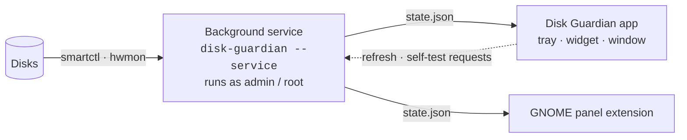

<div align="center">


# Disk Guardian

**在磁盘出故障之前，先了解它。**<br>
为每块磁盘提供 SMART 健康检测、实时温度和早期预警，支持 Windows、macOS 和 Linux。

[](https://github.com/astatinestudio/disk-guardian/releases/latest)
[](https://github.com/astatinestudio/disk-guardian/releases)
[](https://github.com/astatinestudio/disk-guardian/actions/workflows/desktop.yml)
[](../../LICENSE)
[](#download)

[下载](#download) · [功能](#features) · [工作原理](#how-it-works) · [常见问题](#faq) · [开发](../DEVELOPMENT.md)

<sub>[English](../../README.md) · 简体中文 · [Русский](README_ru.md) · [فارسی](README_fa.md)</sub>

</div>

---

## 概述

磁盘很少会毫无征兆地损坏。重新分配的扇区、不断增加的错误计数、磨损的闪存，或是一直高温运行的硬盘，
通常会在故障发生前几周就出现在磁盘自身的 SMART 数据中。**Disk Guardian** 读取电脑中每块磁盘的这些数据，
将其转化为一个健康评分，并用通俗的语言加以解释。它实时监测温度，并在情况变化时提醒你。

它免费且开源（MIT 许可证），可在 Windows 10/11（x64、ARM64、x86）、macOS 10.15+ 以及几乎所有 Linux 发行版上运行。

## 亮点

<table>
<tr>
<td width="33%" valign="top">

**健康状况一目了然**<br>
每块磁盘都有 0–100 的评分和“良好 / 警告 / 危险”状态，每个问题都有通俗的解释。

</td>
<td width="33%" valign="top">

**实时温度**<br>
每隔几秒更新一次，并提供 24 小时图表。不会为了测量温度而唤醒休眠的硬盘。

</td>
<td width="33%" valign="top">

**早期预警**<br>
磁盘温度过高（按磁盘类型设置阈值）或健康状况变差时发出通知。

</td>
</tr>
<tr>
<td valign="top">

**完整信息**<br>
完整的 SMART 属性表、NVMe 健康日志、SAS 计数器、通电时间和写入数据量。

</td>
<td valign="top">

**就在你常看的地方**<br>
托盘或菜单栏中的温度、浮动小组件、Windows 任务栏以及 GNOME 面板扩展。

</td>
<td valign="top">

**私密且轻量**<br>
只读访问磁盘，无需账户，没有广告，也不收集任何数据。应用本身无需管理员权限。

</td>
</tr>
</table>

<a id="features"></a>
## 功能

| 类别 | 内容 |
|---|---|
| **监测** | 健康评分 · SMART 属性 · NVMe 健康日志 · SAS 计数器 · 坏扇区和待处理扇区 · CRC 错误 · SSD 磨损 · 写入 / 读取数据量 |
| **温度** | 实时读数 · 带最低 / 最高值的 24 小时图表 · 按磁盘类型设置的警告和危险阈值 · °C 或 °F |
| **使用情况** | 累计通电时间 · 今日使用 · 14 天每日记录 |
| **自检** | 短时和扩展 SMART 自检，可查看进度和历史结果 |
| **桌面** | 托盘 / 菜单栏温度 · 始终置顶的浮动小组件 · 开机启动 · 自定义磁盘名称 |
| **Windows** | 任务栏中的温度 · 文件资源管理器中驱动器上的健康标记 |
| **Linux** | GNOME Shell 面板扩展 · 分区图（文件系统、LUKS、挂载点、使用率） · btrfs 设备错误和 scrub 状态 · `dg-top` 按进程显示实时 I/O |
| **通用** | 19 种语言，支持从右到左的文字 · 浅色和深色主题 · 经过签名的自动更新 |

### 支持的磁盘

| 磁盘 | 健康 | 温度 |
|---|:---:|:---:|
| SATA 机械硬盘（HDD） | ✓ | ✓ |
| SATA SSD | ✓ | ✓ |
| NVMe SSD | ✓ | ✓ |
| SAS / SCSI | ✓ | ✓ |
| USB 磁盘（通过 USB 转 SATA / NVMe 桥接） | ✓¹ | ✓¹ |
| U 盘 | 基本² | — |

<sub>¹ 前提是 USB 转接器会传递 SMART 数据；大多数都会。² U 盘没有 SMART 数据，Disk Guardian 会显示系统所知道的信息。</sub>

<a id="download"></a>
## 下载

| 系统 | 类型 | x64 | ARM64 | x86（32 位） |
|---|---|:---:|:---:|:---:|
| **Windows** 10 / 11 | 安装程序 | [下载](https://github.com/astatinestudio/disk-guardian/releases/latest/download/Disk-Guardian-Windows-Setup-x64.exe) | [下载](https://github.com/astatinestudio/disk-guardian/releases/latest/download/Disk-Guardian-Windows-Setup-arm64.exe) | [下载](https://github.com/astatinestudio/disk-guardian/releases/latest/download/Disk-Guardian-Windows-Setup-x86.exe) |
| | 便携版（zip） | [下载](https://github.com/astatinestudio/disk-guardian/releases/latest/download/Disk-Guardian-Windows-Portable-x64.zip) | [下载](https://github.com/astatinestudio/disk-guardian/releases/latest/download/Disk-Guardian-Windows-Portable-arm64.zip) | [下载](https://github.com/astatinestudio/disk-guardian/releases/latest/download/Disk-Guardian-Windows-Portable-x86.zip) |
| **macOS** 10.15+ | 磁盘映像（.dmg） | [Intel](https://github.com/astatinestudio/disk-guardian/releases/latest/download/Disk-Guardian-macOS-x64.dmg) | [Apple silicon](https://github.com/astatinestudio/disk-guardian/releases/latest/download/Disk-Guardian-macOS-aarch64.dmg) | — |
| **Debian · Ubuntu · Mint** | .deb | [下载](https://github.com/astatinestudio/disk-guardian/releases/latest/download/Disk-Guardian-Linux-amd64.deb) | [下载](https://github.com/astatinestudio/disk-guardian/releases/latest/download/Disk-Guardian-Linux-arm64.deb) | — |
| **Fedora · openSUSE** | .rpm | [下载](https://github.com/astatinestudio/disk-guardian/releases/latest/download/Disk-Guardian-Linux-x86_64.rpm) | [下载](https://github.com/astatinestudio/disk-guardian/releases/latest/download/Disk-Guardian-Linux-aarch64.rpm) | — |
| **任意 Linux（Arch、Manjaro 等）** | AppImage（便携版） | [下载](https://github.com/astatinestudio/disk-guardian/releases/latest/download/Disk-Guardian-Linux-x86_64.AppImage) | [下载](https://github.com/astatinestudio/disk-guardian/releases/latest/download/Disk-Guardian-Linux-aarch64.AppImage) | — |

**我该选哪个？**

- **安装程序**适合日常使用：它会设置后台服务，并自动保持更新。
- **便携版**无需安装，可从任意文件夹或 U 盘运行，但不会自动更新。
- **ARM64** 适用于 ARM 版 Windows（骁龙笔记本、Surface Pro X）和 ARM Linux；**x86** 仅适用于旧的 32 位 Windows。
- **.deb** 和 **.rpm** 软件包包含后台服务和 GNOME 面板扩展。**AppImage** 可在任何发行版上运行；请先用包管理器安装 `smartmontools`。

所有文件、校验和以及发行说明都在[发布页面](https://github.com/astatinestudio/disk-guardian/releases)上。

**Linux 和 macOS：一条命令完成安装或更新**

```bash
curl -fsSL https://raw.githubusercontent.com/astatinestudio/disk-guardian/main/install.sh | bash
```

该脚本会为你的系统下载最新版本，用该版本的 `SHA256SUMS.txt` 进行校验，然后安装。随时再次运行即可更新。

> [!NOTE]
> 安装包尚未进行代码签名，因此首次启动时 Windows SmartScreen 或 macOS Gatekeeper 可能会要求确认。
> 在 macOS 上，请右键点击应用并选择**打开**。

> [!TIP]
> 在 GNOME 中，安装后请注销并重新登录一次，即可在顶部面板看到磁盘温度。

<a id="how-it-works"></a>
## 工作原理



读取 SMART 数据需要管理员权限，但桌面应用不应以管理员身份运行。因此工作被分成两部分：

- **一个小型后台服务**（Windows 服务、launchd 守护进程或 systemd 单元）定期读取磁盘，并将原始数据写入本地文件。
  它从不唤醒休眠的硬盘。
- **应用**以普通用户身份运行，分析这些数据并加以显示。分析代码与 GNOME 扩展共用，因此两者的结果始终一致。
- **请求**（例如“立即刷新”或“开始自检”）通过一个小队列发回服务，只有本机用户可以写入该队列
  （在 Linux 上仅限 `sudo` 组成员）。

## 隐私与安全

- **只读。** Disk Guardian 只读取磁盘信息。它唯一会请求磁盘执行的操作是 SMART 自检，而且只在你主动开始时进行；
  自检在磁盘内部运行。
- **不收集数据。** 没有账户、统计或广告。唯一的网络请求是检查更新：从本仓库下载 [`updates.json`](../../updates.json)，
  可在**设置 → 更新**中关闭。
- **经过验证的更新。** 每个版本都附带用项目 Ed25519 密钥签名的 `SHA256SUMS.txt`。只有签名和文件哈希都匹配时，
  应用才会安装更新。

## 命令行（Linux）

```bash
sudo dg-top                           # 按磁盘和进程显示实时 I/O，类似 htop
journalctl -u disk-guardian -f        # 查看服务日志
sudo disk-guardian --once             # 读取一次所有磁盘并输出原始 JSON
sudo systemctl restart disk-guardian  # 使 /etc/diskguardian/collector.conf 的修改生效
```

所有服务设置都在[开发文档 → Collector settings](../DEVELOPMENT.md#collector-settings-linux)中说明。

<a id="faq"></a>
## 常见问题

<details>
<summary><b>健康评分有多可靠？</b></summary>

它反映的是磁盘对自身的报告：重新分配和待处理的扇区、介质和 CRC 错误、自检失败，以及 SSD 的剩余寿命。
这能及早发现大多数渐进式故障。突发故障（例如控制器损坏）仍可能毫无预警地发生，所以请备份重要数据。
</details>

<details>
<summary><b>它会阻止硬盘休眠吗？</b></summary>

不会。休眠中的硬盘会被跳过，等它们自行唤醒后再读取。唯一的例外是从未被读取过的磁盘：它会被唤醒一次，以免一直没有数据
（`wake_for_first_scan`，可以关闭）。SSD 和 NVMe 的温度来自内核传感器，不会产生任何磁盘活动。
</details>

<details>
<summary><b>为什么某块磁盘显示“未知”？</b></summary>

该磁盘不提供 SMART 数据。这在虚拟机磁盘、硬件 RAID 控制卡后面的磁盘以及部分 USB 转接器上很常见。
</details>

<details>
<summary><b>更新是如何进行的？</b></summary>

应用在启动时以及每隔几小时检查一次新版本。有新版本时会显示横幅，点击**下载并安装**，经过一次管理员确认即可就地更新。
可以在**设置 → 更新**中关闭自动检查。在 Linux 和 macOS 上，也可以再次运行上面的安装命令。
</details>

<details>
<summary><b>如何卸载？</b></summary>

- **Windows：** 设置 → 应用 → Disk Guardian → 卸载。
- **macOS：** 运行 `sudo "/Applications/Disk Guardian.app/Contents/MacOS/disk-guardian" --uninstall-service`，然后把应用移到废纸篓。
- **Linux：** `sudo apt remove disk-guardian`，或使用 `sudo apt purge disk-guardian` 同时删除历史记录和设置。
</details>

<details>
<summary><b>哪些还不支持？</b></summary>

硬件 RAID 控制卡（megaraid 等）后面的单块磁盘，以及 32 位 ARM Linux。GNOME 面板扩展需要 GNOME 45 或更新版本；其他桌面环境可使用托盘图标和浮动小组件。
</details>

## 参与贡献

欢迎在 [Issues](https://github.com/astatinestudio/disk-guardian/issues) 中报告问题和提出建议，也欢迎提交 Pull Request：
构建、测试和项目结构请参阅[开发文档](../DEVELOPMENT.md)。

**翻译**位于 [`extension/lib/locales/`](../../extension/lib/locales)，每种语言一个文件。特别欢迎母语使用者改进翻译。
`node desktop/scripts/check-locales.mjs` 可以检查是否有遗漏。

## 致谢

- [smartmontools](https://github.com/smartmontools/smartmontools)（GPL-2.0）：`smartctl` 以独立程序的形式随附，未作任何修改。
- [Tauri](https://tauri.app)（MIT / Apache-2.0）：跨平台应用框架。
- [Material Symbols](https://fonts.google.com/icons)（Apache-2.0）：图标。
- [Vazirmatn](https://github.com/rastikerdar/vazirmatn)（SIL Open Font License 1.1）：波斯语 / 阿拉伯语字体。

> [!IMPORTANT]
> Disk Guardian 按“原样”提供，不附带任何担保。健康评分只是估计，并非保证：请务必备份你在意的数据。

---

<div align="center">
<sub>由 <b>Reza Ardi</b> 开发 · 创建于 2026 年 11 月 15 日 · 最后更新于 2026 年 11 月 27 日<br>以 <a href="../../LICENSE">MIT 许可证</a>发布</sub>
</div>
